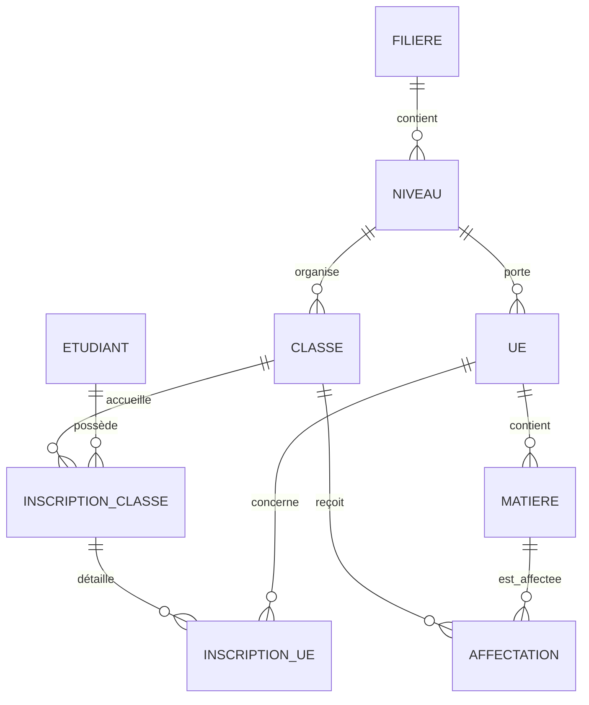

# 02 — Audit PostgreSQL

## Limitation d'accès

Une connexion directe en lecture seule depuis l'environnement d'audit n'a pas pu être établie (`psql` n'a pas retourné de résultat exploitable). Les chiffres ci-dessous sont donc ceux vérifiés précédemment dans le terminal du responsable du projet et repris comme preuves historiques, pas comme nouvelle interrogation live.

## État documenté

- Base : `gnu_notes`.
- Port utilisé : `5435`.
- Schéma métier : `gnu`.
- Tables observées précédemment : 34 tables, dont `universite`, `faculte`, `departement`, `filiere`, `specialite`, `niveau`, `annee_academique`, `classe`, `ue`, `matiere`, `etudiant`, `enseignant`, `inscription_classe`, `inscription_ue`, `affectation`, `evaluation`, `note`, `bulletin`, `requete`, `candidature_rattrapage`, `publication` et `journal_audit`.
- 73 UE importées ; 121 EC du catalogue importés ; 62 UE activées.
- 35 étudiants INF361-SR ; 35 inscriptions classe validées ; 350 inscriptions UE validées.

## Relations constatées

## Contrôles et incohérences

La contrainte d'activation impose un à deux EC par UE. Les écarts documentés de crédits restent à traiter avant publication : `INF461` (UE 6, EC 3), `INF561` (UE 3, EC 6) et `INF571` (UE 3, EC 6). Aucun coefficient distinct n'est présent dans les sources harmonisées ; crédits et pondérations d'évaluation doivent rester séparés.

## Conclusion

Le modèle relationnel couvre les domaines attendus. La vérification live et la résolution des trois écarts de crédits sont bloquantes pour déclarer la conformité PostgreSQL complète.
